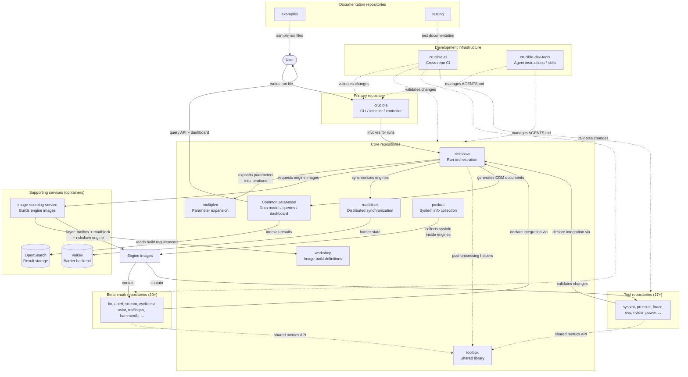

# Crucible Repository Relationships

This diagram shows how the independently versioned repositories in the
Crucible ecosystem relate to one another. Each repo is a separate git
repository, cloned to `repos/` and activated via symlinks in `subprojects/`.

## Reading the diagram

- **Solid arrows** show runtime invocation or data flow during a benchmark run.
- **Dashed arrows** show supporting relationships such as shared libraries,
  validation coverage, or documentation links.
- **Benchmark and tool repos** are collapsed into single nodes for readability;
  each is an independent repository with its own `rickshaw.json`,
  `workshop.json`, and optional `multiplex.json`.
- **Engine images** are built by the image-sourcing service using a layered
  approach: toolbox, roadblock, and the rickshaw engine form cached common
  layers, with the benchmark- or tool-specific layer rebuilt on change.
- **Valkey** is the runtime backend for roadblock barriers; it is a service
  container, not a Crucible repository.
- **OpenSearch** stores indexed CDM documents; the CDM server provides the
  query API and web dashboard on top of it.
